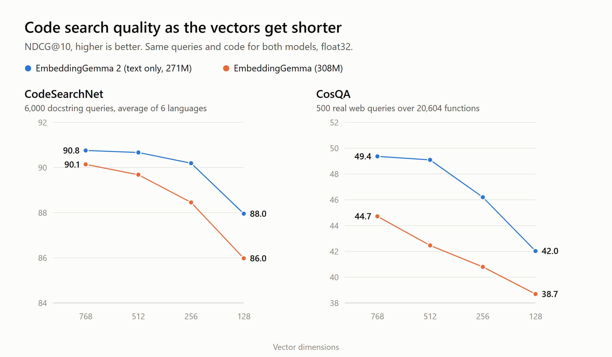

# EmbeddingGemma 2 vs EmbeddingGemma: code search at 768, 512, 256 and 128 dimensions

A small, reproducible benchmark of Google's [EmbeddingGemma 2](https://huggingface.co/google/embeddinggemma-2) (released October 6, 2026) against the first [EmbeddingGemma](https://huggingface.co/google/embeddinggemma-300m), on natural-language code search, at every vector size the model supports. Speed and memory are measured on an ordinary desktop CPU.

Write-up: [EmbeddingGemma 2 at 256 Dimensions Matches the Original at 768](https://medium.com/@ruijin.developer/embeddinggemma-2-my-take-on-googles-new-multimodal-embedding-model-e2c14f848970)



## Results

NDCG@10 (higher is better). CodeSearchNet is the average of its 6 languages; per-language numbers and Recall@10 are in [results/RESULTS.md](results/RESULTS.md).

| Benchmark | Model | 768 | 512 | 256 | 128 |
| --- | --- | ---: | ---: | ---: | ---: |
| CodeSearchNet (6,000 queries) | EmbeddingGemma 2, text only | **90.8** | **90.7** | **90.2** | **88.0** |
| | EmbeddingGemma | 90.1 | 89.7 | 88.5 | 86.0 |
| CosQA (500 web queries, 20,604 functions) | EmbeddingGemma 2, text only | **49.4** | **49.1** | **46.2** | **42.0** |
| | EmbeddingGemma | 44.7 | 42.5 | 40.8 | 38.7 |

- On CosQA, the closest thing here to real developer searches, EmbeddingGemma 2 is 4.7 points ahead at full size, and finds the right function in the top 10 for 81.4% of queries versus 75.0%.
- On CodeSearchNet the full-size gap is small (+0.6). The first model is ahead on Python (96.1 vs 95.5) and JavaScript (83.4 vs 82.5); EmbeddingGemma 2 wins Go (+2.8), Ruby (+1.3), PHP (+1.0) and Java (+0.2).
- EmbeddingGemma 2 at 256 dimensions matches the first model at 768 on CodeSearchNet (90.2 vs 90.1) and beats it on CosQA (46.2 vs 44.7), with a third of the storage.
- Shrinking vectors costs more on the harder benchmark: 768 to 256 costs EmbeddingGemma 2 0.6 points on CodeSearchNet but 3.2 on CosQA, and 128 costs 2.8 and 7.3. Google's model card shows the same pattern for its code average (78.68 at 768, 76.18 at 256, 71.41 at 128).

### Speed and memory (CPU, float32)

Intel Core i7-9700F (8 cores, 2019), 32 GB RAM, PyTorch 2.14.1 CPU build. Query latency is one query at a time; throughput is CosQA functions in batches of 32.

| Model | Parameters loaded | RAM for the model | Peak while loading | Query latency, median | Functions per second |
| --- | ---: | ---: | ---: | ---: | ---: |
| EmbeddingGemma | 307.6M | 1.6 GB | 2.8 GB | 67 to 72 ms | 7.9 to 8.0 |
| EmbeddingGemma 2, text only | 271.0M | 1.5 GB | 3.3 GB | 72 to 81 ms | 4.9 to 5.6 |
| EmbeddingGemma 2, all encoders | 744.4M | 3.3 GB | 5.1 GB | 85 ms | 5.4 to 5.5 |

GB here is 1,024 MB. Ranges cover repeated runs (3 for EmbeddingGemma 2 text only, 2 for the others); the JSON files in `results/` hold the last run and `results/run1/` the first. On this CPU the new model is better but not faster. These are float32 PyTorch numbers, not comparable to Google's quantized on-device figures (about 191 MB for text only on a Pixel 11 Pro).

## Method

- **Models:** `google/embeddinggemma-2` at revision `914f7f8`, loaded text only (`vision_config` and `audio_config` set to `None`, 271.0M parameters), and `unsloth/embeddinggemma-300m` at `bfa3c84`, a byte-identical copy of `google/embeddinggemma-300m` (every weight, tokenizer and config file has the same SHA-256), used because the Google repo needs a Hugging Face login.
- **Data:** [mteb/CodeSearchNetRetrieval](https://huggingface.co/datasets/mteb/CodeSearchNetRetrieval) test splits (1,000 docstring queries and 1,000 functions per language, with docstrings removed from the code) and [mteb/cosqa](https://huggingface.co/datasets/mteb/cosqa) test split (500 web queries, 20,604 functions).
- **Inputs:** identical for both models, using the prefixes from the EmbeddingGemma 2 model card: `task: code retrieval | query: {query}` and `title: none | text: {code}`. Max sequence length 1024.
- **Vector sizes:** each corpus is encoded once at 768 dimensions; 512, 256 and 128 keep the leading dimensions and re-normalize, which is what sentence-transformers' `truncate_dim` does.
- **Scoring:** cosine similarity over the full corpus, NDCG@10, MRR@10, Recall@1 and Recall@10.
- **Hardware:** to save time, most embeddings were computed on a GTX 1050 Ti (PyTorch 2.11.0+cu126); EmbeddingGemma 2's Python, JavaScript, Go, Ruby and Java embeddings were computed on the CPU. GPU and CPU vectors for the same inputs match (cosine similarity 1.000000, largest difference 2.7e-7).

## Limitations

- Both datasets are part of MTEB's code benchmark, which Google reports on, so this is an independent check on known benchmarks, not a test on unseen data.
- Text and code only. Images, video and audio are not tested.
- float32 on a desktop CPU. No quantization and no phone.
- CodeSearchNet queries are docstrings, which are easier than real searches; CosQA is closer to how people search.

## Run it

```bash
python -m venv .venv
.venv/Scripts/activate        # Windows; on macOS or Linux: source .venv/bin/activate
pip install -r requirements.txt pillow torchvision

python bench.py quality --model eg2     # add --device cuda to use a GPU
python bench.py quality --model eg1
python bench.py speed --model eg2
python bench.py speed --model eg2-full
python bench.py speed --model eg1
python bench.py report                   # writes results/RESULTS.md
python chart.py                          # writes results/ndcg-vs-dims.png
```

Models and datasets download from Hugging Face on first use. Embeddings are cached in `cache/`, so a rerun only scores. EmbeddingGemma 2's processor needs Pillow and torchvision even when loaded text only.

Code: [Apache 2.0](LICENSE), the same license as EmbeddingGemma 2.
